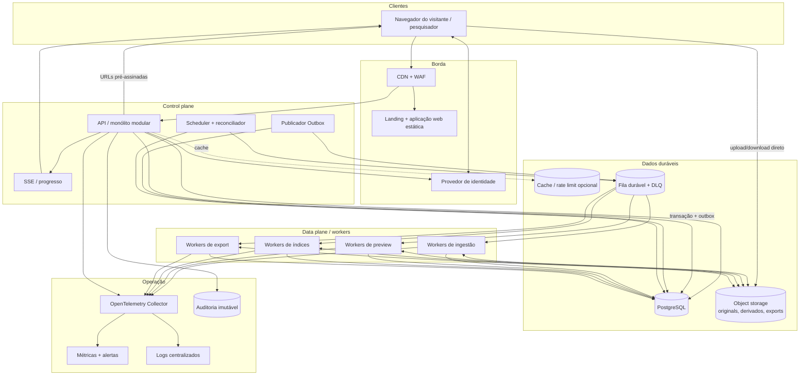

# SpectralIndex Batch Processor — Arquitetura

## 1. Drivers arquiteturais

A arquitetura é orientada por cinco forças: lotes com milhares de imagens, arquivos potencialmente grandes, processamento demorado, reprodutibilidade científica e isolamento entre projetos. Ela deve suportar crescimento sem impor, no MVP, o custo operacional de dezenas de microserviços.

Princípios:

1. **Control plane separado do data plane:** requisições de negócio não transportam grandes binários.
2. **Originals imutáveis:** qualquer normalização, preview ou resultado é um novo objeto derivado.
3. **Processamento assíncrono e idempotente:** estado durável antes de publicar trabalho.
4. **Automação explicável e revisável:** inferências guardam regra, evidência e confiança.
5. **Snapshots versionados:** um job não muda quando ROI, associação ou catálogo evolui.
6. **Falhas locais não invalidam o lote:** o item é a unidade de retry e contenção.
7. **Segurança por projeto em todas as camadas:** autorização não depende apenas da UI.

## 2. Estilo proposto

No MVP, usar um **monólito modular** para a API/control plane, acompanhado por processos de worker independentes e escaláveis. Os módulos compartilham um banco PostgreSQL, mas possuem limites claros, serviços internos e ownership lógico de tabelas. Mensagens e objetos usam contratos versionados.

Esse desenho reduz a complexidade de deployment e transações distribuídas, sem acoplar o processamento científico ao ciclo de requisição web. Módulos de alta carga podem ser extraídos posteriormente sem alterar o domínio público.

### Módulos do control plane

- **Identity & Access:** usuários, sessões, convites, memberships e autorização.
- **Projects:** projetos, quotas, arquivamento e auditoria.
- **Datasets & Ingestion:** sessões de upload, assets, validação e ciclo do dataset.
- **Classification:** regras, inferências, tratamentos, capturas e associação de bandas.
- **ROI:** geometria, versões, validação espacial e compatibilidade.
- **Index Catalog:** definições versionadas, bandas requeridas e schemas de parâmetros.
- **Processing:** criação de jobs/items, estado, cancelamento, progresso e retry.
- **Results & Statistics:** metadados de outputs, estatísticas e comparações.
- **Exports:** pedidos e artifacts de exportação.
- **Audit & Observability:** audit trail, eventos de domínio e links para logs.

## 3. Diagrama da arquitetura

## 4. Componentes e responsabilidades

| Componente | Responsabilidade | Não deve fazer |
|---|---|---|
| Web app | fluxos públicos/autenticados, upload direto, revisão, visualização e progresso | processar rasters grandes ou guardar credenciais do storage |
| API | regras de negócio, autorização, metadados, emissão de URLs e comandos | fazer proxy de grandes arquivos ou executar índices no request |
| PostgreSQL | fonte de verdade transacional, estados, snapshots e outbox | armazenar pixels/binários grandes |
| Object storage | originals, temporários de ingestão, previews, resultados e exports | decidir autorização de negócio |
| Fila durável | desacoplar comandos de longa duração, redelivery e DLQ | ser a fonte definitiva do estado do job |
| Workers | validação, preview, cálculo, estatística e export | confiar no conteúdo da mensagem sem revalidar escopo/versão |
| Scheduler/reconciliador | detectar leases expirados, jobs presos, expiração e limpeza | produzir resultados científicos |
| Observabilidade | métricas, traces, logs e alertas correlacionados | receber tokens, URLs assinadas ou conteúdo sensível desnecessário |

## 5. Armazenamento de objetos

### 5.1 Namespaces/buckets lógicos

Separar por política de acesso e lifecycle, mesmo que inicialmente sejam prefixes no mesmo provedor:

- `originals/{project_id}/{dataset_id}/{asset_id}/{version}`: privado, imutável e sem overwrite.
- `quarantine/{upload_session_id}/...`: upload ainda não confiável, TTL curto e acesso apenas por ingestão.
- `derived/{project_id}/{job_id}/{item_id}/...`: previews, máscaras e resultados versionados.
- `exports/{project_id}/{export_id}/...`: artifacts com retenção/expiração configurável.
- `staging/...`: temporários incompletos, lifecycle agressivo.

Chaves são geradas pelo servidor e não incorporam diretamente nomes fornecidos pelo usuário. O nome original fica em metadados sanitizados no banco.

### 5.2 Upload direto

1. Cliente envia ao backend apenas manifesto de arquivos: nome relativo, tamanho, MIME alegado e checksum quando disponível.
2. Backend autoriza projeto/quota e cria `UploadSession`/`UploadPart`.
3. Backend retorna URLs pré-assinadas de curta duração para PUT ou multipart, limitadas a chave, tamanho e tipo quando o provedor permitir.
4. Cliente envia ao storage, com concorrência e retry controlados, e reporta ETags/parts.
5. Backend conclui multipart e agenda validação via outbox.
6. Worker calcula checksum confiável, detecta tipo por conteúdo e move/promove logicamente de quarantine para original imutável.

Para milhares de arquivos, a API trabalha em páginas/lotes (por exemplo, 100–500 entradas), evitando payloads gigantes. Se o provedor suportar credenciais temporárias prefix-scoped, elas podem reduzir emissão de URLs, mas URLs por objeto são mais simples e restritivas no MVP.

### 5.3 Download

A API autoriza usuário e projeto antes de emitir URL GET curta, com `Content-Disposition` seguro. Para pacotes grandes, um worker cria artifact no bucket de exports; a API nunca concatena arquivos durante a resposta.

## 6. Persistência transacional e mensageria

### PostgreSQL

- UUID/ULID como identificadores externos; timestamps UTC.
- Chaves estrangeiras e constraints garantem invariantes críticas.
- Índices compostos por `project_id`, estado e tempo suportam listagens/claim de trabalho.
- JSONB apenas para snapshots e metadados variáveis; campos consultados e relações ficam normalizados.
- Row-Level Security pode atuar como defesa adicional, mas não substitui autorização na aplicação.
- Particionar tabelas de alto volume (`processing_items`, eventos e logs referenciados) somente quando métricas justificarem.

### Outbox transacional

Alteração de estado e evento outbox são gravados na mesma transação. Um publicador envia o evento à fila e marca `published_at`. Consumidores usam `message_id`/`idempotency_key`, de modo que entrega **at-least-once** não produza duplicidade lógica.

### Fila e prioridade

Filas lógicas separadas por perfil: `ingestion`, `preview`, `processing`, `export`. Cada uma possui DLQ. Prioridades moderadas evitam que um export enorme bloqueie previews interativos; fairness por projeto impede um único lote de monopolizar workers.

## 7. Processamento e consistência

- API valida dataset/ROI/índices, congela snapshots e cria job/items em uma transação.
- Publicação ocorre via outbox; estado `queued` já é consultável antes do worker.
- Worker adquire lease atômico para um item, registra `attempt`, heartbeat e prazo.
- Escrita de output usa chave temporária; checksum e metadados são verificados; somente então o resultado é promovido e o banco recebe referência.
- Finalização do item é compare-and-set pelo `attempt_id`; worker atrasado não sobrescreve retry mais recente.
- Um agregador/reconciliador calcula estado do job a partir dos itens e contadores, sem confiar apenas em eventos incrementais.
- Cancelamento grava `cancel_requested_at`; workers cooperam e o reconciliador conclui o estado.

Detalhes algorítmicos e de estados estão em [PROCESSING_PIPELINE.md](./PROCESSING_PIPELINE.md).

## 8. API e comunicação com o frontend

### Padrões

- API HTTP/JSON versionada (`/api/v1`) com OpenAPI.
- Paginação cursor-based para assets, items, results e logs.
- `Idempotency-Key` em criação de upload, job, retry e export.
- Concorrência otimista via `version`/ETag para revisão de associação e ROI.
- Erros no formato Problem Details, com código estável e correlation ID.
- Filtros são server-side; a UI não carrega milhares de linhas para filtrar localmente.

### Progresso

SSE é a opção preferida por ser unidirecional e simples. Eventos informam apenas que o recurso mudou e/ou trazem contadores compactos; a fonte de verdade continua no banco/API. Polling com `updated_since` é fallback. WebSocket só é necessário futuramente para colaboração bidirecional em tempo real.

### Previews

O visualizador consome thumbnails/tiles derivados, nunca baixa automaticamente o original inteiro. Para o MVP, pirâmides/tiles podem ser gerados sob demanda e cacheados. Rasters float são renderizados no servidor para preview com faixa/colormap configurável, mantendo o original numérico para download.

## 9. Implantação e escalabilidade

### Topologia MVP

- Single-region, duas ou mais réplicas stateless da API atrás de load balancer.
- PostgreSQL gerenciado com backups point-in-time.
- Object storage gerenciado, criptografado e versionado/lock conforme disponibilidade.
- Fila gerenciada com DLQ.
- Pools separados de workers; autoscaling por profundidade/idade da fila e uso de CPU/memória.
- Workers de processamento com disco efêmero limitado e cleanup garantido.
- CDN/WAF para landing e assets públicos; aplicação privada não é cacheada de forma compartilhada.

### Estratégias de escala

- Limitar concorrência de uploads no browser e workers por projeto.
- Streaming/chunked IO; evitar carregar raster completo em memória quando bibliotecas permitirem janelas.
- Agrupar operações de metadados no banco e usar COPY/bulk insert para milhares de assets/items.
- Pré-calcular contadores de progresso, reconciliados periodicamente.
- Cache apenas de dados recomputáveis; invalidação por versão.
- Separar pools por memória/CPU para impedir noisy neighbors.

## 10. Disponibilidade, recuperação e lifecycle

- Backups automáticos do banco, testes periódicos de restore e RPO/RTO definidos antes de produção.
- Versionamento/retention de originals; proteção contra deleção privilegiada acidental.
- Reprocessamento possível a partir de originals + manifesto + versão do algoritmo.
- Mensagens invisíveis apenas durante lease; redelivery após timeout.
- Reconciliador identifica uploads abandonados, multipart incompleto, itens sem heartbeat e artifacts expirados.
- Deploys são backward-compatible: primeiro schema expansivo, depois código, depois remoção em release posterior.
- Jobs continuam usando sua versão de algoritmo; imagens de worker são identificadas por digest imutável.

## 11. Observabilidade e operação

### Telemetria

- Métricas: taxa/latência da API, bytes/arquivos ingeridos, idade/profundidade da fila, duração por índice, retries, falhas por código, jobs presos e custo aproximado.
- Traces: `request_id`, `project_id` pseudonimizado, `job_id`, `item_id`, `attempt_id` e `message_id`.
- Logs JSON estruturados, níveis padronizados e redaction automática.
- Audit trail separado de logs operacionais: ator, ação, recurso, momento, razão e mudança resumida.

### Alertas

- DLQ não vazia, idade de fila acima do SLO, crescimento anormal de falhas, falta de heartbeat, erro de publicação outbox, quota de storage e falha de backup/restore.
- Runbooks devem cobrir replay seguro, liberação de lease, reprocessamento de item e revogação de URL/sessão.

## 12. Limites e contratos entre módulos

- `Dataset ready` é pré-condição para criação de job.
- Processing referencia versões, nunca registros editáveis “atuais”, de ROI, associação e índice.
- Workers recebem IDs, checksums esperados e snapshots mínimos; recuperam acesso ao storage por identidade de workload, não por credencial na mensagem.
- Results não atualiza originals; Exports lê resultados confirmados e snapshots.
- Exclusão lógica de projeto impede novos acessos e trabalhos; deleção física é workflow assíncrono, auditado e sujeito a retenção.

## 13. Decisões arquiteturais (ADRs resumidos)

| Decisão | Motivo | Consequência |
|---|---|---|
| Monólito modular + workers | domínio ainda evolui; baixa complexidade de operação | disciplina de módulos é obrigatória |
| PostgreSQL como fonte de verdade | transações, relações e consultas fortes | exige tuning/particionamento quando crescer |
| Object storage para binários | escala, durabilidade e upload direto | consistência objeto/banco precisa de saga/reconciliação |
| Fila at-least-once + idempotência | padrão robusto e amplamente suportado | consumidores e promotion de output ficam mais complexos |
| Outbox transacional | elimina janela banco-versus-fila | adiciona publicador e limpeza da outbox |
| SSE para progresso | simples e suficiente para eventos server-to-client | polling continua necessário como fallback |
| Snapshot por job | reprodução e histórico | duplicação controlada de metadados |
| Compatibilidade espacial estrita no MVP | evita ROI cientificamente incorreta | menos datasets processáveis sem pré-alinhamento |

## 14. Alternativas consideradas

- **Microserviços desde o início:** melhor isolamento organizacional, porém custo de deployment, observabilidade e consistência não justificado no MVP.
- **Serverless function para o processamento completo:** boa elasticidade, mas limites de duração, memória e disco podem conflitar com rasters grandes. Pode servir previews/exports pequenos; workers em containers são a base segura.
- **Workflow engine completo:** útil para DAGs complexos, mas desnecessário para a primeira pipeline linear. Contratos devem permitir adoção futura.
- **Kafka como backbone:** excelente para streaming/eventos, porém uma fila gerenciada com DLQ atende commands do MVP com menos operação.
- **NoSQL como banco principal:** escala de escrita, mas relações, consistência de estados e auditoria favorecem PostgreSQL.
- **WebSocket:** mais flexível, mas SSE reduz estado/conexão para progresso unidirecional.

## 15. Riscos e trade-offs

- Banco compartilhado pode virar acoplamento; mitigar com schemas/ownership, APIs internas e testes de arquitetura.
- A sincronização storage–banco é eventual; estados `validating`/`generating` e reconciliador tornam isso explícito.
- Reprodutibilidade aumenta storage e exige manter runtimes antigos; definir janela de suporte e imagens por digest.
- Tiles/previews adicionam custo, mas evitam downloads maciços e melhoram UX.
- Autoscaling por profundidade sem fairness pode causar starvation; quotas e filas ponderadas são necessárias.
- Single-region simplifica consistência e custo, mas limita recuperação regional; multi-região é evolução planejada.

## 16. Evolução prevista

Extrair serviços somente quando houver pressão mensurável:

1. Ingestion/preview quando throughput e dependências de imagem divergirem da API.
2. Processing orchestration quando DAGs, múltiplos pools e agendas exigirem workflow engine.
3. Export quando formatos/volume dominarem recursos.
4. Identity quando SSO/organizações elevarem complexidade.

Cada extração preserva IDs, eventos versionados e a semântica definida no modelo de dados.
