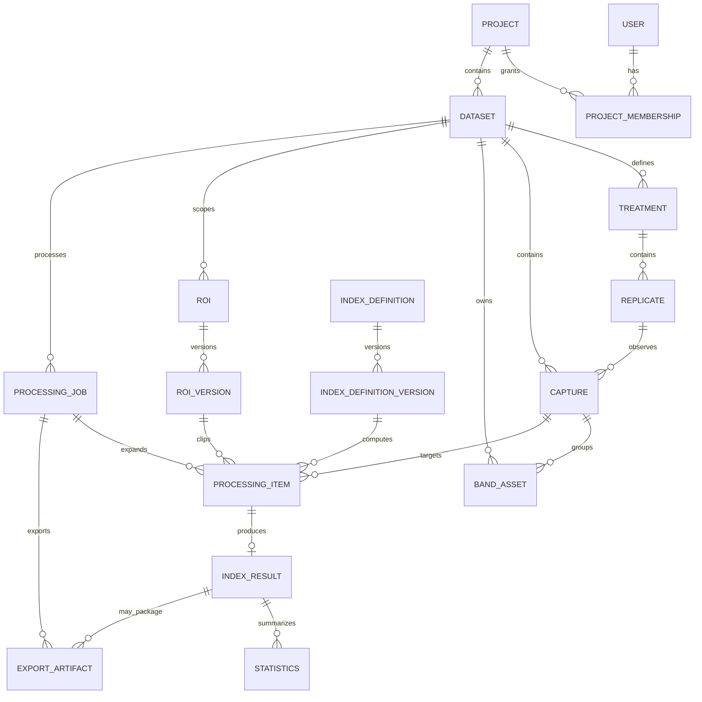

# SpectralIndex Batch Processor — Modelo de Dados e Domínio

## 1. Convenções

- Banco relacional: PostgreSQL.
- IDs públicos: UUID/ULID não sequenciais.
- Datas: `timestamptz` em UTC; API serializa ISO 8601.
- Toda entidade pertencente a um projeto carrega `project_id`, inclusive quando derivável, para autorização, particionamento lógico e consultas seguras.
- Entidades mutáveis possuem `version` para concorrência otimista.
- Exclusão lógica usa `archived_at`/`deleted_at`; deleção física é um workflow de retenção, não um `DELETE` casual.
- Enums ficam no domínio/aplicação com `CHECK` no banco; mudanças exigem migration compatível.
- Binários ficam no object storage. O banco guarda `object_key`, tamanho, MIME detectado, checksum, versão e metadados.
- Campos `created_by`, `updated_by` e eventos de auditoria registram autoria quando aplicável.
- JSONB é reservado a snapshots imutáveis, evidências de detecção e metadados pouco consultados.

## 2. Visão dos relacionamentos



Um `Capture` representa uma observação de um `Replicate`; seus `BandAsset`s devem ser bandas da mesma cena/instante/posição. Uma repetição pode ter várias capturas (por tempo, posição ou sessão).

## 3. Entidades de identidade e colaboração

### 3.1 User

Representa o pesquisador/autenticado, não a credencial em si.

| Campo | Tipo | Regra |
|---|---|---|
| `id` | UUID | PK |
| `email_normalized` | citext | único; não expor em logs |
| `display_name` | text | obrigatório |
| `status` | enum | `pending_verification`, `active`, `suspended`, `deactivated` |
| `email_verified_at` | timestamptz? | requerido para operações sensíveis |
| `auth_subject` | text | ID opaco do provedor de identidade, único |
| `locale`, `timezone` | text | preferências |
| `last_login_at` | timestamptz? | informativo |
| `created_at`, `updated_at` | timestamptz | auditoria |

O sistema nunca armazena senha reversível. Se autenticação for própria, hashes e recovery tokens ficam em módulo/tabela restrita de identidade.

### 3.2 Project

Limite de colaboração, autorização e quota.

| Campo | Tipo | Regra |
|---|---|---|
| `id` | UUID | PK |
| `name`, `description` | text | nome obrigatório |
| `status` | enum | `active`, `archived`, `deletion_pending`, `deleted` |
| `storage_quota_bytes` | bigint | maior ou igual a zero |
| `compute_quota` | jsonb | política versionada |
| `retention_policy` | jsonb | nunca menor que exigência institucional |
| `created_by` | UUID | FK User |
| `created_at`, `updated_at`, `archived_at` | timestamptz |  |
| `version` | bigint | optimistic locking |

### 3.3 ProjectMembership

Relação N:N entre User e Project.

| Campo | Tipo | Regra |
|---|---|---|
| `project_id`, `user_id` | UUID | PK composta/FKs |
| `role` | enum | `owner`, `editor`, `contributor`, `viewer` |
| `status` | enum | `invited`, `active`, `revoked` |
| `invited_by`, `accepted_at`, `revoked_at` | campos de auditoria |  |

Invariantes: projeto ativo deve possuir ao menos um owner ativo; último owner não pode sair sem transferir ownership.

## 4. Entidades de ingestão e experimento

### 4.1 Dataset

Contêiner versionável de uma importação científica dentro do projeto.

| Campo | Tipo | Regra |
|---|---|---|
| `id`, `project_id` | UUID | PK/FK |
| `name`, `description` | text | nome obrigatório |
| `state` | enum | ver máquina de estados |
| `input_convention_id` | UUID? | regra de detecção selecionada |
| `expected_band_set` | jsonb? | bandas esperadas/aliases na ingestão |
| `asset_count`, `accepted_count`, `rejected_count` | bigint | contadores reconciliáveis |
| `total_bytes` | bigint | soma aceita |
| `classification_revision` | bigint | incrementa a cada edição confirmada |
| `confirmed_at`, `confirmed_by` | campos opcionais | associação revisada |
| `created_by`, `created_at`, `updated_at`, `archived_at` | auditoria |  |
| `version` | bigint | optimistic locking |

Estados:

```text
draft -> uploading -> ingesting -> needs_review -> ready -> archived
  |          |            |             |          |
  +----------+------------+-------------+--------> invalid
needs_review <-> ingesting (reanálise controlada)
invalid -> uploading | ingesting | archived (quando corrigível)
```

- `draft`: metadados criados, nenhum upload aberto.
- `uploading`: uma ou mais sessões recebem dados.
- `ingesting`: validação, extração de metadados, preview e detecção em curso.
- `needs_review`: ingestão terminou; associações exigem revisão/confirmação.
- `ready`: revisão confirmada e invariantes satisfeitas; pode originar jobs.
- `invalid`: erro de dataset ou ausência de assets utilizáveis; guarda razão.
- `archived`: somente leitura; jobs históricos continuam consultáveis.

Não se altera silenciosamente um dataset usado por jobs. Novos assets ou uma revisão estrutural fazem o dataset voltar a `needs_review`, mantendo a revisão antiga referenciada pelos jobs.

### 4.2 UploadSession e UploadObject

Entidades operacionais necessárias para upload direto.

**UploadSession**: `id`, `project_id`, `dataset_id`, `mode` (`files`, `directory`, `zip`), `state`, `expires_at`, `idempotency_key`, contadores e ator.

Estados: `created`, `uploading`, `finalizing`, `completed`, `failed`, `expired`, `aborted`.

**UploadObject**: `id`, `upload_session_id`, `client_relative_path`, `safe_display_name`, `storage_key`, `declared_size`, `observed_size`, `declared_mime`, `detected_mime`, `multipart_upload_id`, `etag`, `client_checksum`, `verified_checksum`, `state`, `failure_code`.

Estados: `pending`, `uploading`, `uploaded`, `validating`, `accepted`, `rejected`.

Constraints:

- `client_relative_path` é normalizado; rejeitar caminho absoluto, `..`, NUL e colisão após normalização Unicode/case policy.
- `(upload_session_id, client_relative_path)` único.
- URL assinada só existe para objeto `pending/uploading` e expira.
- `accepted` exige tamanho observado, MIME detectado e checksum verificado.

### 4.3 Treatment

Grupo experimental dentro do dataset.

| Campo | Tipo | Regra |
|---|---|---|
| `id`, `project_id`, `dataset_id` | UUID | FKs |
| `name` | text | rótulo exibido |
| `normalized_key` | text | único no dataset |
| `metadata` | jsonb | fatores experimentais opcionais |
| `source` | enum | `detected`, `manual`, `imported` |
| `created_at`, `updated_at` | timestamptz |  |

### 4.4 Replicate

Unidade experimental repetida dentro de um tratamento. É explícita para impedir que múltiplos pixels ou capturas sejam tratados como repetições independentes.

| Campo | Tipo | Regra |
|---|---|---|
| `id`, `project_id`, `dataset_id`, `treatment_id` | UUID | FKs coerentes |
| `label`, `normalized_key` | text | chave única por treatment |
| `ordinal` | integer? | ordenação opcional |
| `metadata` | jsonb | bloco/vaso/parcela etc. |
| `source` | enum | `detected`, `manual`, `imported` |

### 4.5 Capture

Agrupa assets de bandas que representam a mesma observação.

| Campo | Tipo | Regra |
|---|---|---|
| `id`, `project_id`, `dataset_id`, `replicate_id` | UUID | FKs |
| `capture_key` | text | único no dataset/revisão |
| `captured_at` | timestamptz? | tempo conhecido da aquisição |
| `sequence`, `position_label` | campos opcionais | desempate/ordenação |
| `width`, `height` | integer? | grade de referência |
| `crs`, `affine_transform` | campos espaciais? | quando conhecidos |
| `alignment_status` | enum | `unknown`, `compatible`, `requires_transform`, `incompatible` |
| `detection_evidence` | jsonb | regras e confiança |
| `classification_revision` | bigint | revisão à qual pertence |
| `created_at`, `updated_at` | timestamptz |  |

Uma captura não mistura datasets ou repetições. `treatment_id` é derivado via Replicate e não precisa ser duplicado, salvo materialização controlada para consulta.

### 4.6 BandAsset

Representa um original aceito associado a uma banda/captura. É o registro de proveniência central da entrada.

| Campo | Tipo | Regra |
|---|---|---|
| `id`, `project_id`, `dataset_id`, `capture_id` | UUID | FKs; capture pode ser nulo enquanto não classificado |
| `upload_object_id` | UUID | origem da ingestão, única |
| `band_code` | text? | código canônico, por exemplo `RED`, não o alias bruto |
| `original_filename`, `relative_path` | text | somente exibição/inferência |
| `object_key`, `object_version_id` | text | chave gerada, imutável |
| `sha256` | char(64) | checksum verificado |
| `size_bytes`, `detected_mime`, `format` | campos técnicos |  |
| `width`, `height`, `dtype`, `channel_count` | metadados raster |  |
| `crs`, `affine_transform`, `nodata_value` | metadados espaciais? |  |
| `state` | enum | `validating`, `accepted`, `rejected`, `quarantined`, `archived` |
| `detection_evidence` | jsonb | tratamento/repetição/captura/banda sugeridos, regras e confiança |
| `created_at` | timestamptz | sem `updated_at` para conteúdo original |

Invariantes:

- `(dataset_id, sha256, size_bytes)` pode sinalizar duplicata, mas deduplicação cross-project não revela existência de arquivos.
- Para uma revisão confirmada, `(capture_id, band_code)` é único. Duplicatas exigem decisão explícita.
- `object_key`, versão, checksum e bytes nunca mudam após `accepted`; correção de metadados cria revisão/registro de classificação, não substitui conteúdo.
- Asset rejeitado/quarentenado não participa de jobs.

### 4.7 DetectionSuggestion e ClassificationRevision

Para explicabilidade e histórico, cada inferência pode ser materializada com `asset_id`, `field`, `suggested_value`, `rule_id/version`, `evidence`, `confidence`, `status` (`proposed`, `accepted`, `overridden`, `rejected`) e ator.

`ClassificationRevision` congela o mapeamento `asset -> treatment/replicate/capture/band`. Jobs guardam seu ID e checksum do snapshot, evitando depender do mapeamento atual.

## 5. ROI e sistema espacial

### 5.1 ROI

Identidade lógica editável e nomeada dentro do dataset.

| Campo | Tipo | Regra |
|---|---|---|
| `id`, `project_id`, `dataset_id` | UUID | FKs |
| `name`, `description` | text | nome obrigatório |
| `scope` | enum | `dataset`, `replicate`, `capture` |
| `scope_ref_id` | UUID? | coerente com scope |
| `current_version_id` | UUID | aponta para ROI_VERSION |
| `state` | enum | `active`, `archived` |
| `created_by`, `created_at`, `updated_at` | auditoria |  |

### 5.2 ROIVersion

Versão imutável da geometria.

| Campo | Tipo | Regra |
|---|---|---|
| `id`, `roi_id`, `version_number` | UUID/integer | único por ROI |
| `geometry_type` | enum | `rectangle`, `polygon` |
| `geometry` | geometry/jsonb | polígono válido e fechado |
| `coordinate_space` | enum | `pixel`, `normalized`, `projected` |
| `reference_capture_id`, `reference_asset_id` | UUID | base da criação |
| `reference_width`, `reference_height` | integer | obrigatório para pixel/normalized |
| `crs`, `affine_transform` | opcionais | obrigatório quando projected |
| `geometry_checksum` | text | integridade/snapshot |
| `created_by`, `created_at`, `change_note` | auditoria |  |

Regras:

- Retângulo é persistido como polígono de cinco pontos (primeiro = último), mantendo `geometry_type` para UX.
- Polígono deve ser simples, não vazio, ter área positiva e estar dentro da referência ou ser explicitamente recortado com aviso.
- Aplicação em outra banda produz uma transformação/mascara derivada registrada; nunca reinterpreta coordenadas silenciosamente.
- Jobs referenciam `roi_version_id`, nunca `roi.current_version_id` indiretamente.

## 6. Catálogo de índices

### 6.1 IndexDefinition e IndexDefinitionVersion

`IndexDefinition` é a identidade estável (`NDVI`, por exemplo); `IndexDefinitionVersion` é a definição científica imutável.

Campos da versão: `semantic_version`, `formula_expression` ou implementação registrada, `required_bands`, `optional_bands`, `parameter_schema`, `default_parameters`, `valid_output_range`, `division_by_zero_policy`, `nodata_policy`, `algorithm_package`, `container_digest`, `documentation`, `status` (`draft`, `active`, `deprecated`, `retired`) e checksum.

Jobs só usam versões `active` no momento da submissão. Depreciação não invalida resultados históricos.

## 7. Processamento

### 7.0 ProcessingRecipe

Uma `ProcessingRecipe` é uma definição científica imutável pertencente ao pesquisador e
reutilizável em qualquer dataset ao qual ele tenha acesso. O snapshot da recipe registra
índices, versões exatas das fórmulas, parâmetros e estatísticas selecionadas. Alterar uma
configuração cria outra recipe; não reescreve jobs nem recipes já usadas.

Campos principais: `id`, `owner_id`, `name`, `description`, `schema_version`,
`definition_snapshot`, `definition_checksum`, `created_at`, `updated_at` e `archived_at`.

### 7.1 ProcessingJob

Agregado de execução e snapshot imutável da intenção do usuário.

| Campo | Tipo | Regra |
|---|---|---|
| `id`, `project_id`, `dataset_id` | UUID | FKs |
| `parent_job_id` | UUID? | retry/reexecução derivada |
| `recipe_id` | UUID? | recipe imutável usada na submissão |
| `classification_revision_id` | UUID | revisão congelada |
| `state` | enum | `queued`, `running`, `completed`, `completed_with_errors`, `failed`, `cancelled` |
| `configuration_snapshot` | jsonb | índices, parâmetros, seleção e políticas |
| `reproducibility_snapshot` | jsonb | fórmulas, ROI, mapeamentos, assets/checksums, radiometria e software |
| `snapshot_schema_version`, `snapshot_checksum` | text | contrato e integridade do snapshot canônico |
| `software_version` | text | release que criou/executa o contrato científico |
| `configuration_checksum` | text | integridade/idempotência |
| `idempotency_key` | text | único por projeto/ator/endpoint |
| `item_total`, `item_queued`, `item_running`, `item_succeeded`, `item_failed`, `item_cancelled`, `item_skipped` | bigint | contadores reconciliáveis |
| `progress_basis_points` | integer | 0–10000; derivado |
| `failure_code`, `failure_summary` | text? | erro global sanitizado |
| `cancel_requested_at`, `cancel_requested_by` | campos opcionais | cancelamento cooperativo |
| `queued_at`, `started_at`, `finished_at` | timestamptz? | monotônicos |
| `created_by`, `created_at`, `updated_at` | auditoria |  |

Estados exigidos:

```text
queued -> running -> completed
   |         |  \-> completed_with_errors
   |         |  \-> failed
   |         \----> cancelled
   \--------------> cancelled
```

Semântica terminal:

- `completed`: todos os itens requeridos terminaram em `succeeded` (itens legitimamente `skipped` devem ser definidos na pré-validação, não durante cálculo).
- `completed_with_errors`: ao menos um item `succeeded` e ao menos um `failed`/`skipped` inesperado; resultados parciais disponíveis.
- `failed`: nenhum resultado utilizável por erro global ou todos os itens falharam.
- `cancelled`: cancelamento solicitado e nenhum item continua ativo; resultados já confirmados podem ser consultados, marcados como parciais.
- Estados terminais são imutáveis; retry cria novo job com `parent_job_id`.

### 7.2 ProcessingItem

Unidade de isolamento: uma combinação `(job, capture, roi_version, index_version, parameter_set)`.

| Campo | Tipo | Regra |
|---|---|---|
| `id`, `project_id`, `job_id` | UUID | FKs |
| `capture_id`, `replicate_id` | UUID | snapshot da unidade experimental |
| `roi_version_id`, `index_definition_version_id` | UUID | versões imutáveis |
| `input_snapshot` | jsonb | asset IDs, object versions e checksums |
| `parameter_snapshot` | jsonb | validado contra schema da versão |
| `formula_version`, `formula_expression` | text | definição científica explícita e congelada |
| `input_snapshot` | jsonb | assets, versões de objeto e checksums exatos |
| `band_mapping_snapshot`, `roi_snapshot` | jsonb | associação e geometria usadas, sem consulta ao estado atual |
| `state` | enum | `queued`, `running`, `succeeded`, `failed`, `cancelled`, `skipped` |
| `idempotency_key` | text | único dentro do job |
| `attempt_count`, `max_attempts` | smallint | limites |
| `lease_owner`, `lease_expires_at`, `heartbeat_at` | campos operacionais | somente durante running |
| `progress_basis_points`, `current_stage` | campos derivados | 0–10000 |
| `failure_class` | enum? | `transient`, `deterministic`, `cancelled` |
| `failure_code`, `failure_detail_safe` | text? | sem segredo/PII |
| `queued_at`, `started_at`, `finished_at` | timestamptz? |  |

Transições:

```text
queued -> running -> succeeded
   |         |  \-> failed
   |         \----> cancelled
   |         \----> queued   (retry transitório, nova attempt)
   \-> skipped
   \-> cancelled
```

`skipped` é usado quando a pré-condição é conhecida (por exemplo, banda ausente sob política explícita), sempre com código. Em configuração estrita, a criação do job é recusada em vez de gerar skips.

### 7.3 ProcessingAttempt

Cada tentativa é append-only: `id`, `item_id`, número, worker/runtime/container digest, horários, lease, status, código de erro, métricas de recurso, log correlation ID e checksums temporários. Permite diagnosticar retry sem apagar a falha anterior.

### 7.4 IndexResult

Resultado científico confirmado de um item bem-sucedido.

| Campo | Tipo | Regra |
|---|---|---|
| `id`, `project_id`, `processing_item_id` | UUID | item único; FK |
| `raster_object_key`, `object_version_id` | text | output imutável |
| `sha256`, `size_bytes`, `mime_type` | integridade | obrigatório |
| `format`, `dtype` | text | `GeoTIFF/TIFF`, obrigatoriamente `float32` no export científico |
| `width`, `height`, `crs`, `affine_transform` | metadados raster | CRS pode ser nulo |
| `nodata_value`, `valid_pixel_count`, `masked_pixel_count` | qualidade | NaN/nodata explícito |
| `range_min`, `range_max` | double? | conveniência, não substitui Statistics |
| `quality_flags` | jsonb | avisos versionados |
| `algorithm_version`, `container_digest` | text | proveniência |
| `created_at` | timestamptz | imutável |

Resultado só é criado após upload completo, checksum e validação. Constraint: um resultado confirmado por item; retry após sucesso retorna o existente.

### 7.5 Statistics

Registro de estatística derivada com escopo explícito.

| Campo | Tipo | Regra |
|---|---|---|
| `id`, `project_id`, `job_id` | UUID | FKs |
| `index_result_id` | UUID? | para estatística de resultado |
| `scope_type` | enum | `capture_roi`, `replicate`, `treatment` |
| `scope_id` | UUID | capture/replicate/treatment coerente |
| `index_definition_version_id`, `roi_version_id` | UUID | contexto |
| `aggregation_method` | text | por pixels, média de capturas etc. |
| `sample_unit` | enum | `pixel`, `capture`, `replicate` |
| `valid_count`, `missing_count` | bigint |  |
| `mean`, `median`, `stddev`, `min`, `max`, `p05`, `p25`, `p75`, `p95` | double? | nulo se insuficiente |
| `additional_metrics` | jsonb | apenas métricas versionadas |
| `calculation_version`, `created_at` | proveniência |  |

Invariante científica: estatística de tratamento declara `sample_unit=replicate` quando compara repetições; pixels não são promovidos implicitamente a réplicas.

## 8. Exports, logs e auditoria

### 8.1 ExportArtifact

Pedido e arquivo derivado de exportação.

| Campo | Tipo | Regra |
|---|---|---|
| `id`, `project_id`, `job_id` | UUID | FKs |
| `type` | enum | `csv`, `xlsx`, `geotiff`, `manifest_json`, `bundle_zip` |
| `selection_snapshot`, `options_snapshot` | jsonb | filtros e formato congelados |
| `state` | enum | `queued`, `generating`, `ready`, `failed`, `expired` |
| `object_key`, `object_version_id`, `sha256`, `size_bytes` | opcionais até ready | output imutável |
| `failure_code`, `failure_detail_safe` | text? |  |
| `expires_at` | timestamptz? | artifact pode expirar; registro histórico permanece |
| `created_by`, `created_at`, `started_at`, `finished_at` | auditoria |  |

Transições: `queued -> generating -> ready | failed`; `ready -> expired`. Retry cria nova tentativa ou novo artifact, preservando falhas.

### 8.2 ProcessingLogRef

O banco mantém somente índice/referência de logs: `job_id`, `item_id`, `attempt_id`, timestamp, nível, código, mensagem sanitizada, trace ID e localização no sistema central. Payloads extensos obedecem retenção operacional.

### 8.3 AuditEvent

Append-only e separado de logs: `id`, `project_id?`, `actor_type`, `actor_id`, `action`, `resource_type`, `resource_id`, `occurred_at`, `request_id`, IP truncado/hasheado conforme política, `change_summary`, `reason` e assinatura/hash opcional.

Eventos mínimos: login/recuperação, mudança de membership, criação/arquivamento/exclusão, emissão/finalização de upload, confirmação de associação, versão de ROI, submissão/cancelamento/retry de job, download/export e acesso administrativo excepcional.

## 9. Manifesto de processamento

O manifesto é um documento JSON versionado produzido de dados normalizados e snapshots, contendo:

- `manifest_schema_version`, IDs, timestamps e checksums.
- projeto/dataset e `classification_revision_id` sem PII desnecessária.
- assets: ID, caminho relativo sanitizado, banda, capture, tamanho, MIME, versão do objeto e SHA-256.
- tratamento, repetição e captura.
- ROI versionada, espaço de coordenadas, geometria e transformação aplicada.
- definições/versões dos índices, fórmulas, parâmetros e políticas de nodata.
- job/items/attempts, estados, códigos de erro e tempos.
- runtime: pacote, commit/release, container digest e versões relevantes de bibliotecas.
- resultados/estatísticas/artifacts com SHA-256.
- avisos de qualidade, retries e itens omitidos.

O manifesto não contém URL pré-assinada, token, segredo, caminho interno do worker ou log bruto.

## 10. Constraints e índices recomendados

- `unique(project_id, id)` quando necessário para FKs compostas que garantem mesma tenancy.
- `unique(dataset_id, treatment.normalized_key)`.
- `unique(treatment_id, replicate.normalized_key)`.
- `unique(dataset_id, classification_revision, capture.capture_key)`.
- `unique(capture_id, band_code, classification_revision)` para associação confirmada.
- `unique(job_id, processing_item.idempotency_key)`.
- `unique(processing_item_id)` em IndexResult.
- Índices parciais para jobs/items ativos por `state`, `queued_at` e `lease_expires_at`.
- Índices por `(project_id, created_at desc)` em datasets, jobs, exports e audit events.
- GIST para geometria ROI somente se PostGIS for adotado; caso contrário, geometria validada em JSON e bbox em colunas numéricas.

## 11. Invariantes de autorização e imutabilidade

1. Toda leitura/escrita verifica membership ativa e ação permitida no `project_id` do recurso.
2. FKs/constraints impedem referência cruzada entre projetos.
3. Original aceito não pode alterar chave, versão, checksum ou bytes.
4. ROI version, classification revision, index definition version, job snapshot, attempt, result e audit event são append-only.
4.1. PostgreSQL rejeita `UPDATE` dos campos científicos de jobs, items e recipes por trigger.
5. Job terminal não retorna a estado ativo.
6. Item `succeeded` possui exatamente um IndexResult confirmado.
7. Export `ready` possui objeto, versão, checksum e tamanho.
8. Nenhum objeto em quarantine participa de processamento.
9. Contadores são caches verificáveis; o estado terminal deve ser reconciliável a partir dos itens.
10. Deleção física respeita retenção e produz evento auditável; references históricas são tombstoned de modo explícito.

## 12. Política de evolução do schema

- Migrations expand/contract; workers de duas versões consecutivas devem coexistir durante deploy.
- Eventos, manifests e snapshots possuem `schema_version` e leitores tolerantes a campos novos.
- Renomear enum/campo requer período de dupla leitura/escrita.
- Backfill é assíncrono, paginado e observável.
- Dados científicos derivados nunca são “corrigidos in place”; nova versão/reexecução substitui apenas a preferência de exibição, não o histórico.
