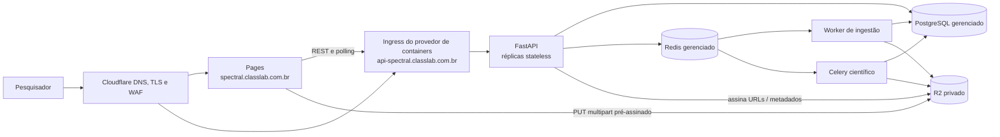

# Deployment de produção

## Topologia aprovada

O endereço público do produto será `https://spectral.classlab.com.br`. A API usa
`https://api-spectral.classlab.com.br`; ambos pertencem à zona Cloudflare já existente
`classlab.com.br` e permanecem configuráveis.



API e workers são stateless. `/tmp` é apenas espaço efêmero de trabalho; originais,
resultados, previews e exports ficam no R2. Nenhum volume local deve ser montado nos
containers em produção.

## Pré-requisitos de segurança

- Zona `classlab.com.br` ativa no mesmo account Cloudflare do Pages.
- Registry de imagens com tags imutáveis por commit e digest.
- Provedor de containers com rede privada, secret manager e execução de jobs one-shot.
- PostgreSQL gerenciado com TLS, backups automáticos e PITR.
- Redis gerenciado com TLS, autenticação, persistência e política de memória definida.
- Bucket R2 de produção e token de API limitado somente a esse bucket.
- Tenant Auth0 com uma SPA e uma API RS256 configuradas.

Em produção, `X-Dev-User-Id` é desativado. A SPA usa Authorization Code + PKCE pelo SDK
Auth0 e envia access token Bearer; a API valida assinatura RS256, `issuer`, `audience`,
expiração e subject usando o JWKS do tenant. O `sub` é persistido como identidade imutável
do usuário e todos os recursos continuam filtrados pelo owner interno.

## 1. Build e publicação dos containers

Use o SHA completo do commit. Nunca publique apenas `latest` como referência de deploy.

```bash
docker build --pull -f infrastructure/docker/api.Dockerfile \
  -t REGISTRY/spectral-api:GIT_SHA .
docker build --pull -f infrastructure/docker/worker.Dockerfile \
  -t REGISTRY/spectral-worker:GIT_SHA .
docker push REGISTRY/spectral-api:GIT_SHA
docker push REGISTRY/spectral-worker:GIT_SHA
```

Os builds são multi-stage, executam como UID/GID `10001`, validam a carga de Rasterio,
GDAL e do driver GeoTIFF, e recebem `SIGTERM` diretamente. O runtime contém somente as
bibliotecas nativas necessárias (`libgdal`, PROJ, GEOS e certificados CA).

Registre no release:

- SHA do commit;
- digest de cada imagem;
- revisão Alembic;
- versão do frontend;
- resultado dos testes e do scan de vulnerabilidades/SBOM.

## 2. PostgreSQL e Redis gerenciados

Crie banco e usuário exclusivos para a aplicação. A URL deve usar o driver async e TLS,
por exemplo `postgresql+asyncpg://.../spectral_index?ssl=require`. Entregue a URL apenas
pelo secret manager. Não permita acesso público irrestrito; autorize somente a rede/egress
da API, do migration job e dos workers.

O Redis deve fornecer URL TLS (`rediss://...`) por secret, sem exposição pública. Separe
Redis de produção de ambientes de staging. Como Redis transporta fila e resultados
temporários, habilite a política de persistência recomendada pelo provedor e alerte antes
de atingir o limite de memória; não use eviction silenciosa de chaves da fila.

## 3. Cloudflare R2 privado

Crie um bucket dedicado, por exemplo `spectral-index-production`.

1. Mantenha **Public Development URL (`r2.dev`) desativada**.
2. Não conecte custom domain ao bucket.
3. Crie um R2 API Token `Object Read & Write` limitado somente ao bucket.
4. Armazene Access Key ID e Secret Access Key no secret manager dos containers.
5. Aplique a política CORS versionada:

```bash
npx wrangler r2 bucket cors set spectral-index-production \
  --file infrastructure/cloudflare/r2-cors.json
npx wrangler r2 bucket cors list spectral-index-production
```

6. Configure Bucket Lock/retention no prefixo de originais (`originals/`) conforme a
   política institucional. Teste primeiro em staging: lock pode impedir correção e remoção
   legítimas.
7. Configure lifecycle apenas para áreas derivadas/temporárias. Não expire originais ou
   manifestos científicos sem uma política formal de retenção.

Variáveis do R2:

```text
SPECTRAL_S3_ENDPOINT_URL=https://ACCOUNT_ID.r2.cloudflarestorage.com
SPECTRAL_S3_PUBLIC_ENDPOINT_URL=https://ACCOUNT_ID.r2.cloudflarestorage.com
SPECTRAL_S3_REGION=auto
SPECTRAL_S3_BUCKET=spectral-index-production
SPECTRAL_S3_FORCE_PATH_STYLE=false
```

O endpoint S3 é necessário também para URLs pré-assinadas; não use custom domain de R2
para elas. URLs pré-assinadas são bearer tokens: prazo curto, operação e object key
específicos, nunca em logs. O browser envia arquivos diretamente ao R2. A API recebe
somente comandos, metadados e confirmação de upload.

## 4. Secrets e configuração dos containers

Use `.env.example` somente como catálogo. Em produção injete os valores individualmente
pelo secret manager. Segredos obrigatórios:

- `SPECTRAL_DATABASE_URL`;
- `SPECTRAL_REDIS_URL`;
- `SPECTRAL_S3_ACCESS_KEY_ID`;
- `SPECTRAL_S3_SECRET_ACCESS_KEY`;
- `SPECTRAL_AUTH0_DOMAIN` (não secreto);
- `SPECTRAL_AUTH0_AUDIENCE` (não secreto).

Configuração recomendada inicial:

```text
SPECTRAL_ENVIRONMENT=production
SPECTRAL_LOG_LEVEL=INFO
SPECTRAL_DEV_AUTH_ENABLED=false
SPECTRAL_AUTH0_DOMAIN=SEU_TENANT.auth0.com
SPECTRAL_AUTH0_AUDIENCE=https://api-spectral.classlab.com.br
SPECTRAL_CORS_ORIGINS=["https://spectral.classlab.com.br"]
SPECTRAL_API_MAX_REQUEST_BYTES=16777216
SPECTRAL_API_REQUEST_TIMEOUT_SECONDS=30
SPECTRAL_API_WORKERS=2
SPECTRAL_API_KEEPALIVE_SECONDS=5
SPECTRAL_GRACEFUL_SHUTDOWN_SECONDS=45
SPECTRAL_READINESS_TIMEOUT_SECONDS=5
SPECTRAL_PROCESSING_CONCURRENCY=2
SPECTRAL_PROCESSING_TASK_SOFT_LIMIT_SECONDS=900
SPECTRAL_PROCESSING_TASK_HARD_LIMIT_SECONDS=930
SPECTRAL_PROCESSING_MAX_TASKS_PER_CHILD=25
```

Comece com dois processos API por container e dois processos científicos por container.
Dimensione Celery por memória, não por CPU apenas: `concurrency × pico de RAM por raster`
deve caber com margem de ao menos 30%. O limite HTTP de 16 MiB é intencional: grandes
imagens usam R2 multipart. Use limite equivalente no ingress, acrescido apenas do overhead
de requisição.

## 5. Migration job

Migration não faz parte do start de cada réplica. Execute uma vez, com a mesma imagem da
API que será implantada:

```bash
docker run --rm --network REDE_PRIVADA \
  --env-file ARQUIVO_SEGURO_DE_RUNTIME \
  REGISTRY/spectral-api:GIT_SHA migrate
```

No orquestrador, prefira um pre-deploy job com retry desabilitado após erro lógico. Capture
o log, confirme código zero e só então atualize API/workers. Migrations devem seguir
**expand-and-contract**: primeiro alterações compatíveis; remoções somente após todo o
fleet deixar de depender das colunas antigas.

## 6. API e workers

API:

- comando: `serve`;
- porta interna: `8000`;
- liveness: `GET /health`;
- readiness: `GET /ready`;
- termination grace: pelo menos 60 s;
- filesystem read-only e `/tmp` efêmero;
- duas ou mais réplicas em zonas distintas após validar carga.

Worker de ingestão:

- comando: `ingestion`;
- filesystem read-only e `/tmp` efêmero;
- liveness do container valida Redis;
- termination grace: pelo menos 60 s.

Worker científico Celery:

- comando: `celery`;
- concurrency inicial `2`;
- timeout soft `900 s`, hard `930 s`;
- `prefetch=1`, late ack e reciclagem após 25 tarefas;
- filesystem read-only e `/tmp` efêmero dimensionado para **um item por slot**.

O ingress deve encerrar TLS, ocultar a porta de origem e aceitar somente tráfego via
Cloudflare quando o provedor permitir. Use TLS `Full (strict)` entre Cloudflare e origem.
Configure `api-spectral.classlab.com.br` como CNAME para o hostname do ingress (ou A/AAAA
para IP estável), com proxy Cloudflare ativo. Aplique WAF/rate limiting no edge; o limiter
em memória da API é apenas defesa adicional por processo.

## 7. Cloudflare Pages

Crie o projeto Pages conectado ao repositório:

| Campo | Valor |
|---|---|
| Production branch | branch de release |
| Root directory | `/` |
| Build command | `npm ci && npm run build` |
| Build output | `apps/web/dist` |
| Node | `22.16.0` (`.nvmrc`) |
| `VITE_API_BASE_URL` | `https://api-spectral.classlab.com.br` |
| `VITE_AUTH0_DOMAIN` | `SEU_TENANT.auth0.com` |
| `VITE_AUTH0_CLIENT_ID` | client ID público da SPA |
| `VITE_AUTH0_AUDIENCE` | `https://api-spectral.classlab.com.br` |

Os arquivos `_headers` e `_redirects` são copiados ao build e fornecem headers de
segurança/cache e fallback da SPA. `VITE_*` é público; nunca coloque segredos nessas
variáveis.

## 8. Auth0

No tenant Auth0:

1. crie uma **Application → Single Page Application**;
2. use `https://spectral.classlab.com.br` em Allowed Callback URLs, Allowed Logout URLs
   e Allowed Web Origins;
3. crie uma **API** com identifier `https://api-spectral.classlab.com.br` e algoritmo
   RS256;
4. habilite RBAC apenas quando houver papéis reais; ownership não depende de role;
5. configure as variáveis Auth0 no Pages e na API/worker Railway;
6. use um pesquisador de teste para validar que dois `sub` diferentes não enxergam os
   mesmos projetos.

Não use client secret no frontend. Alterar fórmula científica, owner ou permissões com
claims do navegador não é permitido; a API deriva a identidade somente do token validado.

## 9. Railway

No Railway, cada processo é um serviço independente: `api`, `worker-ingestion` e
`worker-processing`, além dos templates gerenciados PostgreSQL e Redis. Use os Dockerfiles
existentes e referências de variáveis entre serviços. O roteiro exato está em
[`infrastructure/railway/README.md`](../infrastructure/railway/README.md).

Depois de um deploy Pages bem-sucedido: **Workers & Pages → projeto → Custom domains →
Set up a domain → `spectral.classlab.com.br`**. Não crie apenas um CNAME manual: associe
primeiro o domínio ao projeto Pages para que TLS e roteamento sejam provisionados.

## 10. Ordem do deploy e smoke test

1. Build, testes, scan e push de imagens imutáveis.
2. Backup automático saudável e restore recente validado.
3. Migration job.
4. Worker de ingestão e Celery.
5. API; aguardar `/ready` retornar `200` e todos os checks `ok`.
6. Pages.
7. Smoke test com usuário de teste real: login, criar projeto/dataset, upload TIFF pequeno,
   validar banda, ROI, job, resultado e download.

```bash
curl --fail https://api-spectral.classlab.com.br/health
curl --fail https://api-spectral.classlab.com.br/ready
```

## Rollback

Aplicação e frontend:

1. Pare novos starts de processamento se houver incompatibilidade de release.
2. Reimplante os digests anteriores de API e workers.
3. No Pages, selecione o deployment anterior e faça rollback/promote.
4. Confirme `/ready`, taxa de erros, filas e um fluxo de leitura.

Banco:

- Não execute downgrade Alembic automaticamente em incidente.
- Migrations compatíveis permanecem no banco durante rollback do código.
- Se uma mudança destrutiva tiver escapado, restaure em uma nova instância até um ponto
  anterior, valide e faça cutover controlado. Nunca sobrescreva a instância corrente sem
  preservar evidência e uma rota de retorno.

R2:

- Não reverta originais. Eles são imutáveis.
- Artefatos derivados de uma release defeituosa permanecem ligados ao job/versionamento e
  podem ser regenerados por um novo job; não os substitua silenciosamente.

Consulte [OPERATIONS.md](./OPERATIONS.md) para backup, alertas e runbooks.

## Referências

- [Cloudflare Pages: custom domains](https://developers.cloudflare.com/pages/configuration/custom-domains/)
- [Cloudflare R2: presigned URLs](https://developers.cloudflare.com/r2/api/s3/presigned-urls/)
- [Cloudflare R2: CORS](https://developers.cloudflare.com/r2/buckets/cors/)
- [Cloudflare R2: bucket locks](https://developers.cloudflare.com/r2/buckets/bucket-locks/)
- [Railway: deploy FastAPI](https://docs.railway.com/guides/fastapi)
- [Railway: databases](https://docs.railway.com/databases)
- [Auth0 React SDK](https://auth0.com/docs/libraries/auth0-react)
- [Auth0 FastAPI API](https://auth0.com/docs/quickstart/backend/fastapi)
- [Docker: multi-stage builds](https://docs.docker.com/build/building/multi-stage/)
