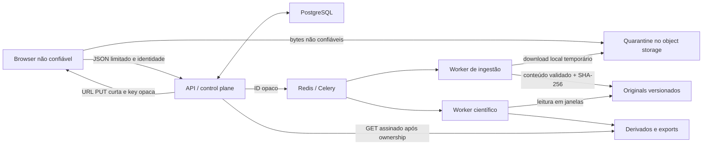

# Modelo de ameaças e auditoria de segurança

**Sistema:** SpectralIndex Batch Processor 0.1.0  
**Auditoria:** 1 de setembro de 2026  
**Escopo:** frontend React, API FastAPI, PostgreSQL, Redis/Celery, workers de
ingestão/processamento, MinIO e compatibilidade S3/R2.

## 1. Resumo executivo

A auditoria combinou revisão de código, testes adversariais, execução das
suites, análise de configuração, procura de segredos e auditoria das
dependências Python e npm.

Não foi encontrada uma rota capaz de visualizar, baixar, processar ou excluir
recursos de outro owner. As rotas testadas retornam `404`, evitando também a
confirmação da existência do recurso. Queries usam SQLAlchemy ou SQL textual
parametrizado; não foi encontrado SQL montado por interpolação. O frontend não
usa `dangerouslySetInnerHTML`, `eval` ou APIs equivalentes.

Foram encontradas e corrigidas lacunas relevantes em validação de conteúdo,
ZIP, cotas, multipart, nomes, configuração de autenticação de desenvolvimento,
CORS, limites HTTP, rate limiting, containers e dependências. Os principais
riscos residuais são bloqueadores de produção: ainda não existe um provedor de
identidade real e o Compose local usa uma credencial MinIO ampla compartilhada.
O ambiente atual é adequado para desenvolvimento local, não para exposição à
Internet.

## 2. Ativos e objetivos de segurança

| Ativo | Confidencialidade | Integridade | Disponibilidade |
| --- | --- | --- | --- |
| Originais e checksums | crítica | crítica e imutável | alta |
| ROIs e associação de bandas | alta | crítica para reprodutibilidade | alta |
| Resultados, estatísticas e exports | alta | crítica | alta |
| Projetos/datasets e identidade | alta | alta | alta |
| Recipes e snapshots de jobs | alta | crítica e versionada | alta |
| Credenciais de banco/storage/fila | crítica | crítica | crítica |
| Logs e mensagens de erro | interna | alta | média |

Objetivos prioritários:

- nenhum acesso cruzado entre usuários;
- nenhum conteúdo enviado executado ou servido como conteúdo ativo;
- originals aceitos não são sobrescritos;
- entradas hostis não atravessam paths nem esgotam recursos sem limites;
- URLs assinadas concedem somente a operação e objeto autorizados;
- falha de um arquivo permanece isolada;
- segredos e traces internos não chegam a respostas, manifests ou logs públicos.

## 3. Fronteiras de confiança e fluxo

Quarantine, nomes, metadados TIFF/EXIF, diretório central de ZIP, mensagens da
fila e todos os IDs recebidos são tratados como não confiáveis.

## 4. Achados corrigidos nesta auditoria

| ID | Severidade | Achado | Correção aplicada |
| --- | --- | --- | --- |
| SEC-001 | alta | `dev_auth_enabled=true` podia ser configurado em produção | configuração staging/production agora rejeita essa combinação |
| SEC-002 | alta | extensão era verificada, mas assinatura e driver não | magic bytes e driver exato são obrigatórios para TIFF/PNG/JPEG |
| SEC-003 | crítica | extração ZIP dependia do tamanho declarado no diretório central | extração streaming conta bytes reais, confirma tamanho/CRC e remove saída parcial |
| SEC-004 | alta | não havia cota total de sessão/dataset | cotas por arquivo, sessão, dataset, ZIP e raster foram adicionadas |
| SEC-005 | média | partes multipart fora do plano podiam receber URLs | emissão é limitada ao número planejado e completion exige a sequência completa |
| SEC-006 | alta | caminhos absolutos eram normalizados em vez de rejeitados e nomes chegavam às keys | paths absolutos/drive/traversal/controles são rejeitados; nomes são normalizados; keys são opacas |
| SEC-007 | média | sem limite de body, headers defensivos ou rate limit de aplicação | limite ASGI streaming, CSP/headers e limites geral/upload foram adicionados |
| SEC-008 | alta | Pillow 12.1.0 tinha 19 advisories conhecidos | atualização para Pillow 12.3.0; novo scan sem vulnerabilidades conhecidas |

Nenhum ajuste foi feito apenas para satisfazer testes: cada mudança corresponde
a uma condição adversarial reproduzida ou a uma configuração insegura
confirmada.

## 5. Upload direto e URLs pré-assinadas

### Controles implementados

- API autentica e resolve o dataset por `dataset.id + owner.id` antes de emitir URL.
- A key é gerada pelo servidor como `quarantine/{session UUID}/{object UUID}.ext`.
- Nome e path do cliente não controlam a key de quarantine ou original.
- URL é restrita a `PUT` ou a um único part, bucket e key, com TTL entre 60 e
  3600 segundos; default de 900 segundos.
- Upload simples assina `Content-Length` declarado e usa
  `application/octet-stream`, ignorando MIME fornecido como prova de tipo.
- Multipart somente assina parts dentro do total calculado; completion exige
  `[1..N]`, sem lacunas ou duplicatas.
- `HEAD` posterior deve confirmar exatamente o tamanho declarado.
- SHA-256 é calculado pelo worker; checksum do cliente, quando informado, precisa
  coincidir.
- O objeto fica em quarantine até validação e não possui endpoint de download.
- Downloads e previews só recebem URL após consulta owner-scoped do recurso pai.
- A aplicação não registra URLs assinadas completas.

### Ameaças cobertas

| Ameaça | Mitigação |
| --- | --- |
| IDOR na emissão de PUT/part | lookup conjunto de sessão, objeto e owner; `404` para outro owner |
| Troca de key/bucket/operação | parâmetros são server-side e assinados |
| Upload maior que o manifesto | `Content-Length`, plano multipart e `HEAD` exato |
| Extensão/MIME falso | validação pós-upload por assinatura, driver e decodificação |
| URL vazada | TLS requerido em produção, TTL curto e escopo de um objeto/operação |
| Sobrescrita por nome repetido | UUID em toda key e detecção de checksum duplicado no dataset |

### Risco residual

S3 multipart incompleto precisa de lifecycle rule/rotina de expiração no
provedor. O rate limit em processo reduz abuso, mas não substitui rate limit
distribuído por usuário/projeto no gateway. Alguns provedores não aplicam
`Content-Length` em PUT da mesma maneira; a confirmação por `HEAD` permanece
obrigatória.

## 6. Arquivos e TIFF não confiáveis

O worker nunca importa ou executa código do upload. Ele abre somente arquivos
locais temporários e allowlisted. Para TIFF, PNG e JPEG:

- extensão, assinatura binária e driver Rasterio/GDAL precisam concordar;
- largura, altura, número de bandas, pixels e bytes decodificados têm limite;
- todas as bandas são decodificadas em janelas fixas de no máximo 1024 × 1024,
  sem confiar no tamanho de bloco declarado pelo TIFF;
- corrupção fora do primeiro tile não é aceita silenciosamente;
- metadata possui limite de quantidade e tamanho;
- preview é re-encodado como PNG controlado e limitado a 1600 px;
- exceptions do parser viram código estruturado sem stack trace para o usuário;
- um arquivo inválido não cancela os irmãos do lote.

Validar todos os blocos aumenta I/O de ingestão. Esse custo é deliberado para
não promover um original parcialmente corrompido.

## 7. ZIP, traversal e decompression bombs

Antes da extração, o worker rejeita:

- path absoluto Unix, drive Windows, `.`/`..`, segmentos vazios e controles;
- profundidade ou segmento excessivo;
- paths duplicados após NFC + `casefold`;
- entrada criptografada, symlink, device ou tipo especial;
- quantidade, tamanho individual, total expandido ou razão de compressão acima
  dos limites;
- arquivo ZIP/cabeçalho central corrompido.

Durante a extração, cada chunk incrementa um contador independente do diretório
central. Ultrapassar o limite ou o tamanho declarado interrompe a operação e
remove o arquivo parcial. `zipfile` confirma CRC ao chegar ao fim. Cada membro é
extraído para um nome temporário UUID; o path do ZIP nunca é concatenado ao
filesystem.

Entradas inválidas recebem erro individual. A validação estrutural insegura do
arquivo ZIP inteiro encerra o archive, pois não é seguro continuar confiando em
sua tabela de membros.

## 8. Limites configuráveis

| Controle | Default |
| --- | ---: |
| Arquivos por sessão | 10.000 |
| Arquivo individual | 50 GiB |
| Bytes declarados por sessão | 100 GiB |
| Bytes por dataset | 1 TiB |
| Entradas por ZIP | 10.000 |
| Entrada ZIP expandida | 50 GiB |
| ZIP expandido total | 100 GiB |
| Razão de compressão | 200:1 |
| Profundidade de path ZIP | 16 |
| Pixels por raster | 500 milhões |
| Bandas por raster | 64 |
| Raster decodificado estimado | 64 GiB |
| Body da API | 16 MiB |
| Requests gerais por IP/processo/minuto | 600 |
| Requests mutáveis de upload por IP/processo/minuto | 60 |

Esses defaults são tetos técnicos, não promessa comercial. Produção deve
reduzi-los conforme memória, disco temporário, timeout e quota contratada.

## 9. Autenticação, cookies, tokens, CSRF e CORS

### Estado atual

O projeto possui apenas uma ponte local `X-Dev-User-Id`. Ela cria identidade de
desenvolvimento e não é autenticação. Em staging/production, a aplicação agora
falha na configuração caso essa ponte seja habilitada e, sem um IdP real,
retorna `401`. Portanto, **OIDC/OAuth2 real é bloqueador de produção**.

Não existem cookies de sessão, access tokens ou refresh tokens no código atual.
O UUID guardado em `localStorage` pelo frontend é somente a identidade local de
desenvolvimento, não uma credencial. CSRF não é aplicável enquanto a API não
autentica por cookie e CORS não permite credenciais. Ao integrar autenticação:

- preferir Authorization Bearer com validação de issuer, audience, assinatura,
  expiração e nonce; ou cookie `Secure`, `HttpOnly`, `SameSite=Lax/Strict`;
- se houver cookie, adicionar token CSRF em toda mutação;
- nunca armazenar bearer/refresh token em `localStorage`;
- implementar revogação, rotação, timeout e MFA administrativo.

CORS aceita somente origens HTTP(S) exatas, sem wildcard, credenciais, path,
query ou userinfo; staging/produção exigem HTTPS. O header de desenvolvimento só
entra na allowlist quando a ponte local está habilitada.

## 10. Autorização, IDOR e isolamento

O modelo atual é ownership individual. Toda entrada pública resolve o recurso
com `id` e `owner_id`; recursos filhos são obtidos a partir de pais já
autorizados ou repetem o owner filter. Respostas de outro usuário usam `404`.

Foram testados com uma segunda identidade:

- listar/abrir/editar/arquivar projeto;
- listar/abrir/excluir dataset;
- criar/listar job, obter progresso, cancelar e reprocessar;
- visualizar resultados e preview direto por `IndexResult.id`;
- listar/criar/baixar exports;
- abrir captura, listar previews e criar/editar/excluir ROI;
- criar/listar upload, emitir parts, completar, retry, marcar falha e cancelar.

Assim, outro usuário não recebe URL assinada para download ou preview, não
consegue iniciar processamento, nem excluir o dataset/arquivo por uma rota
indireta.

Defesa adicional recomendada: constraints compostas `(resource_id, owner_id)` e
PostgreSQL Row-Level Security. Hoje o isolamento depende corretamente da camada
de aplicação, mas um futuro endpoint sem filtro ainda seria um ponto único de
falha.

## 11. SQL injection, XSS e nomes maliciosos

Queries ORM e SQL textual usam bind parameters. A busca não encontrou
`text(f"...")`, SQL por `.format`, shell command com input, `eval` ou `exec`.
Teste adversarial persiste aspas, `<script>` e `DROP TABLE` como dados e confirma
que a tabela continua operacional.

Nomes e paths passam por NFC, rejeição de controles/traversal e substituição de
caracteres fora da allowlist. Eles não entram em filesystem ou object key. O
frontend renderiza valores como children React e não usa HTML bruto. Produção
recebe CSP `default-src 'none'`, `frame-ancestors 'none'`, `nosniff`, DENY,
Referrer-Policy e Permissions-Policy. Previews são PNG re-encodados; conteúdo
arbitrário nunca é servido como HTML/SVG.

## 12. Segredos e infraestrutura

- `.env` e `.env.*` são ignorados; somente `.env.example` com placeholders é
  mantido.
- `SecretStr` evita exposição casual de DSNs/chaves em repr.
- procura automatizada por padrões de chave privada, AWS key e assignments de
  segredo não encontrou candidatos no código versionável.
- manifests científicos não incluem DSNs, tokens ou URLs assinadas.
- API/workers rodam como UID 10001, root filesystem read-only, `/tmp` limitado,
  todas as Linux capabilities removidas, `no-new-privileges` e limite de PIDs.

O Compose local ainda fornece `MINIO_ROOT_*` à API e aos workers e Redis local
não usa autenticação. As portas estão vinculadas a `127.0.0.1`, mas isso não é
aceitável em produção. Produção requer identidades separadas e de privilégio
mínimo:

- API: presign/control plane sem leitura ampla de originals;
- ingestão: leitura de quarantine, create-only em originals/previews;
- processamento: read-only em originals, escrita somente em derived;
- export: leitura de resultados, escrita somente em exports;
- migration: identidade separada da aplicação.

Também são necessários bucket versioning + Object Lock/WORM ou policy explícita
que negue overwrite/delete para identidades comuns. O campo `immutable=true`,
UUID nas keys e versionamento local evitam sobrescrita acidental, mas não
substituem IAM/Object Lock.

## 13. Dependências e supply chain

Resultados em 2026-09-01:

- `pip-audit --local`: zero vulnerabilidades conhecidas após Pillow 12.3.0;
- `npm audit`: zero vulnerabilidades em dependências e devDependencies;
- `npm audit --omit=dev`: zero vulnerabilidades de runtime;
- `pip check`: dependências compatíveis.

Limitações: pacotes internos não existem no PyPI e são corretamente pulados pelo
scanner. Imagens base e serviços usam tags, não digests, e Trivy não estava
instalado; portanto a auditoria de CVEs das imagens não foi concluída. CI deve
gerar SBOM, executar scan de filesystem/container, fixar imagens por digest e
verificar assinatura/proveniência.

## 14. Rate limiting e disponibilidade

A API possui baseline em processo por IP, com bucket separado para mutações de
upload, `429` e `Retry-After`. O body é contado durante streaming, cobrindo
requests chunked sem `Content-Length`. Manifests possuem limites Pydantic e
quota é reservada antes da URL.

O baseline não é distribuído nem identifica usuário/projeto. Produção exige
WAF/API gateway ou contador Redis atômico por IP + subject + projeto, limites de
jobs/exports simultâneos, fair scheduling e cleanup de sessões/multipart
expirados. O endereço de cliente deve vir apenas de proxy confiável, nunca de
`X-Forwarded-For` arbitrário.

## 15. Riscos residuais e decisão de release

| Risco residual | Severidade | Situação/ação obrigatória |
| --- | --- | --- |
| Ausência de autenticação OIDC real | crítica | bloqueia qualquer deploy público |
| Credencial MinIO root compartilhada; imutabilidade sem IAM/Object Lock | crítica | criar service accounts/policies e retenção antes de dados reais |
| Rate limit somente em memória/IP | média | adicionar controle distribuído/gateway |
| Worker ainda tem egress e credenciais amplas | alta | network policy, identidades separadas, seccomp/AppArmor e timeout externo |
| Multipart/quarantine expirado sem janitor demonstrado | média | lifecycle + reconciliador de quota/abort |
| Sem scan de malware | média | integrar scanner; parser sandbox continua obrigatório |
| Sem RLS/constraints cross-owner compostas | média | defesa adicional antes de colaboração multiusuário |
| Imagens não fixadas por digest e sem scan de container | alta | SBOM/Trivy/signature no CI |
| Sem DAST/fuzz contínuo dos parsers | média | fuzz corpus e pentest antes do MVP público |
| Redis local sem autenticação/TLS | alta em produção | serviço privado autenticado/TLS; Compose é apenas local |

**Decisão:** aprovado para desenvolvimento local controlado. Reprovado para
produção pública até resolver os dois riscos críticos e os itens de identidade,
IAM/storage e supply chain classificados como bloqueadores.

## 16. Evidências automatizadas

Principais arquivos de teste:

- `tests/api/test_security.py`: IDOR de upload, paths, nomes, quotas, multipart,
  SQL/XSS, CORS, body e rate limit;
- `tests/api/test_projects.py`: isolamento e deleção de projeto/dataset;
- `tests/api/test_processing.py`: jobs, resultados, preview e exports owner-scoped;
- `tests/api/test_rois.py`: captura, preview de banda e ROI owner-scoped;
- `tests/api/test_uploads.py`: extensão, interrupção, retry, checksum e lotes;
- `tests/worker/test_inspection.py`: magic bytes, TIFF corrompido, limites,
  traversal, duplicidade e ZIP bomb;
- `tests/common/test_config.py`: CORS, segredos e proibição de dev auth implantada.

Na conclusão da auditoria, a suite completa, Ruff, formatação e MyPy estrito
estavam aprovados. Os warnings restantes vêm de depreciação futura/ausência de
georreferenciamento em fixtures Rasterio e não indicam falha de segurança.
